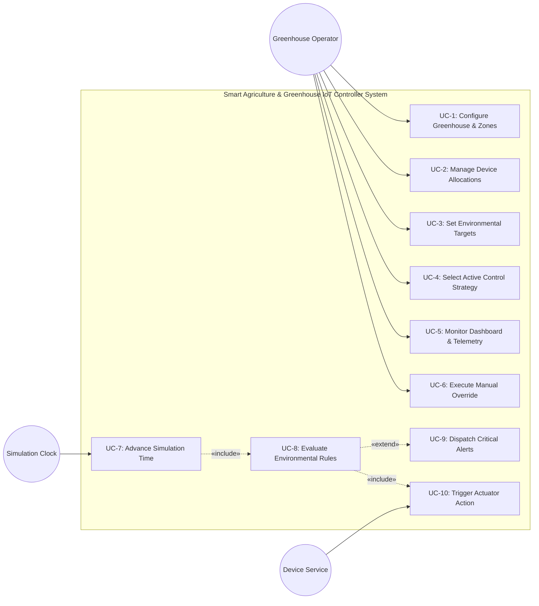
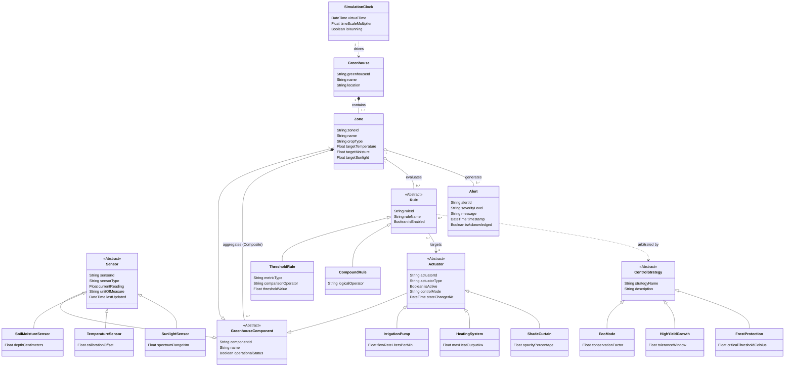
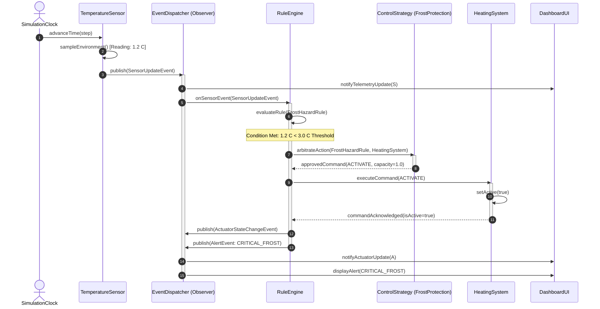
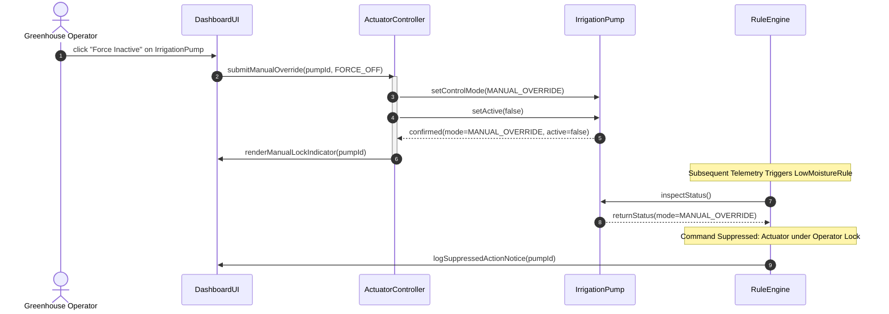
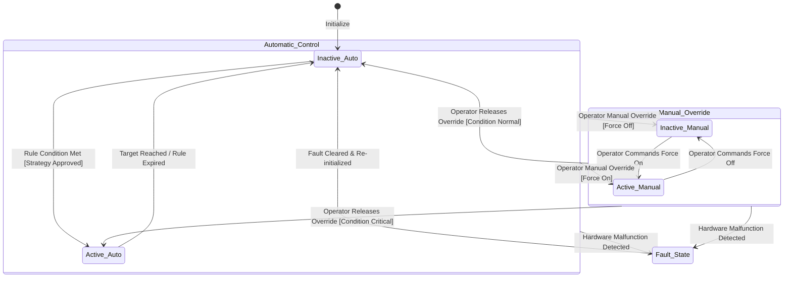
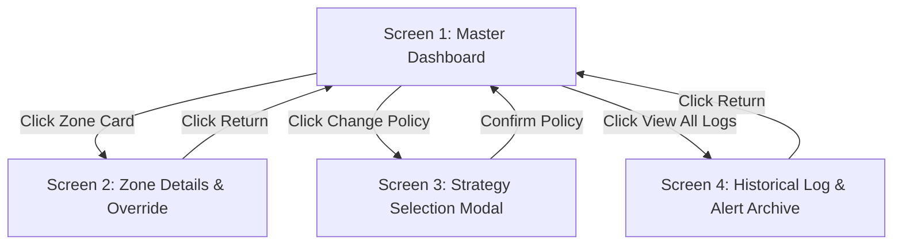

# REQUIREMENTS ANALYSIS DOCUMENT

**For:** Smart Agriculture and Greenhouse IoT Controller System (3Bits)  
**Document Issue No:** 1.0  
**Issue Date:** October 2026  

**Prepared by:**  
- Nuri Ziya Kırtepe  
- Muhammed Korkmaz  
- Derya Uysal  

**Course:** CSE443 - Object-Oriented Analysis and Design  
**Project Team:** 3Bits  
**Target Repository:** `nziyak/3Bits_Smart_Agriculture_Systems`  

---

## TABLE OF CONTENTS

1. [Introduction](#1-introduction)  
   1.1 [Purpose of the system](#11-purpose-of-the-system)  
   1.2 [Scope of the system](#12-scope-of-the-system)  
   1.3 [Objectives and success criteria of the project](#13-objectives-and-success-criteria-of-the-project)  
   1.4 [Definitions, acronyms, and abbreviations](#14-definitions-acronyms-and-abbreviations)  
   1.5 [References](#15-references)  
   1.6 [Overview](#16-overview)  
2. [Current system](#2-current-system)  
3. [Proposed system](#3-proposed-system)  
   3.1 [Overview](#31-overview)  
   3.2 [Functional requirements](#32-functional-requirements)  
   3.3 [Nonfunctional requirements](#33-nonfunctional-requirements)  
       3.3.1 [Usability](#331-usability)  
       3.3.2 [Reliability](#332-reliability)  
       3.3.3 [Performance](#333-performance)  
       3.3.4 [Supportability](#334-supportability)  
       3.3.5 [Implementation](#335-implementation)  
       3.3.6 [Interface](#336-interface)  
       3.3.7 [Packaging](#337-packaging)  
       3.3.8 [Legal](#338-legal)  
   3.4 [System models](#34-system-models)  
       3.4.1 [Scenarios](#341-scenarios)  
       3.4.2 [Use case model](#342-use-case-model)  
       3.4.3 [Object model](#343-object-model)  
       3.4.4 [Dynamic model](#344-dynamic-model)  
       3.4.5 [User interfaces and Mock-ups](#345-user-interfaces-and-mock-ups)  
4. [Glossary of Terms](#4-glossary-of-terms)  
5. [Priority](#5-priority)  
6. [Traceability](#6-traceability)  

---

## 1 Introduction

### 1.1 Purpose of the system
The Smart Agriculture and Greenhouse IoT Controller System is an event-driven software simulation and monitoring platform engineered to automate environmental regulation within a modern greenhouse facility. The system models heterogeneous hardware devices—including soil moisture, ambient temperature, and sunlight sensors, alongside irrigation pumps, heating coils, and automated shade curtains—as interacting software abstractions. 

The software collects environmental telemetry, applies configurable evaluation rules, executes dynamic control policies, and coordinates actuators to maintain ideal agronomic conditions without human intervention, while supporting manual supervisor overrides and historical diagnostic observation.

### 1.2 Scope of the system
The scope of this project encompasses:
- Modeling a virtual greenhouse partitioned into one or more independently managed environmental zones.
- Establishing extensible abstractions for sensors and actuators.
- Providing an event-driven publish-subscribe telemetry pipeline.
- Implementing a polymorphic rule evaluation engine capable of evaluating single-variable and multi-variable boundary conditions.
- Implementing dynamic control strategies (EcoMode, HighYieldGrowth, FrostProtection) to resolve policy trade-offs.
- Supporting priority manual operator overrides with explicit provenance tracking.
- Simulating virtual time progression and dynamic environmental phenomena (weather changes, soil absorption, crop transpiration).
- Providing an operator dashboard displaying live system health, alerts, and operational telemetry.

**Out of Scope:**
- Physical hardware deployment, direct embedded micro-controller firmware programming, or electrical sensor calibration in the real physical world.
- Commercial billing, accounting, and supply chain inventory management modules.

### 1.3 Objectives and success criteria of the project
- **Object-Oriented Design Excellence**: Adhere to core object-oriented principles (Abstraction, Encapsulation, Inheritance, Polymorphism, Composition).
- **Design Pattern Utilization**: Correctly apply the Composite Pattern for hierarchical zone management, the Observer Pattern for telemetry event distribution, and the Strategy Pattern for interchangeable control policies.
- **Decoupled Architecture**: Eliminate direct dependencies between sensors, rule evaluators, actuators, and user-interface layers.
- **Extensibility**: Facilitate the integration of new sensor types, actuator models, rule evaluation logic, or control policies without altering existing core engine logic.
- **Simulation Fidelity**: Accurately simulate time-stepped or continuous environmental changes and demonstrate timely automated corrective responses.

### 1.4 Definitions, acronyms, and abbreviations
- **EARS**: Easy Approach to Requirements Syntax
- **GUI**: Graphical User Interface
- **IoT**: Internet of Things
- **NFR**: Non-Functional Requirement
- **FR**: Functional Requirement
- **OOAD**: Object-Oriented Analysis and Design
- **RAD**: Requirements Analysis Document
- **UML**: Unified Modeling Language
- **Zone**: An isolated spatial section of a greenhouse maintaining dedicated environmental parameters.
- **Telemetry**: Automated measurement data generated by sensors and transmitted across the event pipeline.

### 1.5 References
- CSE443 Course Syllabus and Lecture Notes on Object-Oriented Analysis and Design.
- Project Definition Specification: *Smart Agriculture and Greenhouse IoT Controller Systems*, Department of Computer Engineering.
- Gamma, E., Helm, R., Johnson, R., & Vlissides, J. (1994). *Design Patterns: Elements of Reusable Object-Oriented Software*. Addison-Wesley.
- IEEE Std 830-1998: *IEEE Recommended Practice for Software Requirements Specifications*.

### 1.6 Overview
The remainder of this document outlines the current state of greenhouse management systems (Section 2), describes the functional and non-functional requirements of the proposed platform alongside UML analysis models (Section 3), provides a glossary of domain terminology (Section 4), establishes requirement priorities (Section 5), and maps requirements to use cases and architecture components via a traceability matrix (Section 6).

---

## 2 Current system

Traditional greenhouse management relies on manual labor, localized standalone controllers, or rudimentary timer-based relays:
1. **Manual Inspection and Sampling**: Operators manually measure soil moisture using handheld probes, read wall-mounted thermometers, and observe sunlight levels. This approach is labor-intensive, error-prone, and incapable of continuous 24/7 monitoring.
2. **Delayed Intervention**: Because physical readings are taken periodically, micro-climate anomalies—such as unexpected cold snaps, heatwaves, or rapid soil desiccation—are frequently detected only after crop damage or stress has occurred.
3. **Siloed and Inflexible Equipment**: Existing analog thermostats, pump timers, and mechanical roof vents operate independently without central coordination. For instance, a heater may operate simultaneously with ventilation curtains, resulting in extreme energy waste.
4. **Lack of Policy Flexibility**: Conventional automation systems operate on static, hard-coded thresholds. They cannot dynamically balance resource conservation (e.g., water/energy restrictions) against high-yield commercial objectives based on external context.
5. **Absence of Centralized Provenance**: When equipment fails or operates unexpectedly, operators have no centralized event audit trail to diagnose whether the action was triggered by an automation fault or a manual command.

The proposed software replaces these disparate and manual workflows with a unified, event-driven, intelligent object-oriented controller platform.

---

## 3 Proposed system

### 3.1 Overview
The proposed Smart Agriculture and Greenhouse IoT Controller System models physical greenhouse infrastructure as an interconnected hierarchy of software abstractions. The system monitors multiple micro-climate zones in real time via simulated sensor networks, processes environmental updates through a polymorphic rule engine, applies specialized control strategies to arbitrate actuator actions, and provides supervisors with a comprehensive monitoring and manual override console.

### 3.2 Functional requirements
All functional requirements are organized by functional subsystem and authored according to the Easy Approach to Requirements Syntax (EARS) standard using the *"The system shall..."* formulation.

#### Subsystem 1: Greenhouse and Zone Management
- **FR-1**: The system shall allow operators to create, configure, and remove virtual greenhouse instances.
- **FR-2**: The system shall allow operators to add, reconfigure, and delete greenhouse zones within a greenhouse instance.
- **FR-3**: The system shall allow operators to configure target environmental parameter ranges (soil moisture, temperature, light levels) for each individual zone.
- **FR-4**: The system shall allow operators to associate sensors and actuators with specific greenhouse zones.
- **FR-5**: The system shall maintain zone components in a composite structure capable of aggregating operational status across all contained devices.
- **FR-6**: The system shall provide visual zone summaries and detailed individual zone diagnostics upon operator request.

#### Subsystem 2: Sensor Management and Telemetry
- **FR-7**: The system shall support heterogeneous sensor models including soil moisture sensors, ambient temperature sensors, and sunlight/lux sensors through a common sensor abstraction.
- **FR-8**: The system shall maintain identifying metadata, operational status, engineering units, associated zone, and timestamped readings for each registered sensor.
- **FR-9**: The system shall periodically acquire telemetry readings from all operational sensors as virtual simulation time advances.
- **FR-10**: The system shall generate an update event and broadcast telemetry whenever a sensor measurement changes or exceeds configured boundary values.
- **FR-11**: The system shall detect and record sensor failure states when a sensor produces invalid readings or becomes unresponsive.

#### Subsystem 3: Actuator Management and Manual Override
- **FR-12**: The system shall model heterogeneous actuators including irrigation pumps, heating coils/systems, and automated shade curtains through a common actuator abstraction.
- **FR-13**: The system shall allow authorized automation rules and operators to activate, deactivate, and configure operational parameters of any registered actuator.
- **FR-14**: The system shall allow operators to issue priority manual override commands to force an actuator into an active or inactive state.
- **FR-15**: The system shall maintain an explicit operational mode indicator (Automatic vs. Manual Override) for every actuator.
- **FR-16**: When an actuator is placed under manual override, the system shall suppress automated rule activations directed at that specific actuator until manual control is relinquished.
- **FR-17**: The system shall allow operators to return a manually overridden actuator back to automatic regulation.
- **FR-18**: The system shall log all actuator state transitions along with the commanding provenance (Rule Engine vs. Manual Operator).

#### Subsystem 4: Rule Engine and Polymorphic Processing
- **FR-19**: The system shall provide an extensible rule evaluation engine that processes environmental events dispatched by sensors.
- **FR-20**: The system shall evaluate environmental conditions polymorphically through specialized condition subclasses without inspecting concrete device types.
- **FR-21**: The system shall evaluate boundary conditions including low soil moisture, excessive heat, sub-threshold frost conditions, and excessive solar irradiance.
- **FR-22**: The system shall evaluate compound multi-variable conditions combining multiple environmental metrics simultaneously.
- **FR-23**: The system shall trigger corresponding environmental correction actions when evaluation rule conditions evaluate to true.
- **FR-24**: The system shall deactivate triggered actuators when environmental metrics return within acceptable target ranges.

#### Subsystem 5: Control Strategy Management
- **FR-25**: The system shall support interchangeable environmental control policies via a common strategy abstraction.
- **FR-26**: The system shall implement an **EcoMode** strategy that minimizes water and electricity consumption by extending acceptable environmental tolerances and deferring non-critical actuation.
- **FR-27**: The system shall implement a **HighYieldGrowth** strategy that prioritizes optimal micro-climate conditions to maximize crop growth rates.
- **FR-28**: The system shall implement a **FrostProtection** strategy that prioritizes heating and enclosure protection over power conservation during low-temperature events.
- **FR-29**: The system shall allow operators to switch the active control strategy at runtime without restarting the application or modifying core rule engine components.

#### Subsystem 6: Event-Driven Pipeline and Notifications
- **FR-30**: The system shall distribute telemetry notifications from sensors to subscribers via an asynchronous publish-subscribe observer mechanism.
- **FR-31**: The system shall dispatch high-priority alert notifications to the user interface when critical environmental conditions (drought, frost, extreme overheating) are detected.
- **FR-32**: The system shall dispatch warning alerts when device faults or conflicting rule directives are detected.
- **FR-33**: The system shall maintain historical telemetry measurements and system alert logs separated from current device states.

#### Subsystem 7: Simulation and Virtual Time Progression
- **FR-34**: The system shall provide a virtual simulation clock supporting discrete step-by-step advancement and continuous scaled-time progression.
- **FR-35**: As virtual time progresses, the system shall dynamically calculate environmental changes including soil moisture evaporation, thermal dissipation, and solar diurnal cycles.
- **FR-36**: The system shall allow operators to pause, resume, and adjust the execution speed factor of the virtual simulation clock.

#### Subsystem 8: Monitoring Dashboard and User Interface
- **FR-37**: The system shall render a centralized monitoring dashboard presenting real-time zone states, sensor readings, active actuators, and the currently active control strategy.
- **FR-38**: The system shall provide visual indications explaining the rationalization behind each automated actuator command (e.g., triggered rule, initiating sensor, active strategy).

### 3.3 Nonfunctional requirements

#### 3.3.1 Usability
- **NFR-1**: The user interface shall provide clear visual separation between automatic system activations and manual operator overrides.
- **NFR-2**: All critical environmental alerts (e.g., frost hazard, severe drought) shall be visually prominent within the monitoring dashboard within 1 second of occurrence.
- **NFR-3**: The dashboard shall display all environmental metrics using standardized engineering units (Celsius for temperature, percentage for moisture, Lux for illumination).

#### 3.3.2 Reliability
- **NFR-4**: The software engine shall handle individual sensor failure events without crashing or corrupting adjacent zone monitoring routines.
- **NFR-5**: Conflicting rule evaluations (e.g., simultaneous heat and vent requests) shall fail gracefully into safe fallback states governed by the active control strategy.
- **NFR-6**: The system state shall remain consistent under rapid simulation clock speed multipliers (up to 100x real-time speed).

#### 3.3.3 Performance
- **NFR-7**: The event dispatch pipeline shall deliver a sensor state update to all registered observers within 50 milliseconds in a simulated execution environment.
- **NFR-8**: The rule engine shall complete evaluation of all registered zone rules within 100 milliseconds following a telemetry update event.
- **NFR-9**: The dashboard user interface shall maintain a minimum rendering refresh rate of 30 frames per second during continuous simulation.

#### 3.3.4 Supportability
- **NFR-10**: The architecture shall allow adding new sensor models or actuator types by subclassing base abstractions without modifying existing zone or rule engine classes (Open/Closed Principle).
- **NFR-11**: The strategy pipeline shall allow integration of new specialized control policies without recompilation or alteration of the domain model.

#### 3.3.5 Implementation
- **NFR-12**: The application shall be designed following strict object-oriented paradigms using a strongly-typed object-oriented language.
- **NFR-13**: The system shall strictly decouple domain model classes from presentation components and concrete persistence stores.

#### 3.3.6 Interface
- **NFR-14**: All device abstractions (Sensor, Actuator) shall expose standardized, contract-based programming interfaces.
- **NFR-15**: The presentation tier shall interact with domain models exclusively through defined controller and facade interfaces.

#### 3.3.7 Packaging
- **NFR-16**: The complete deliverable shall be packaged and version-controlled within the official team GitHub repository according to course guidelines.
- **NFR-17**: The project repository shall contain all documentation, architectural diagrams, and build configuration files required for execution.

#### 3.3.8 Legal
- **NFR-18**: The software and documentation shall comply with academic honesty regulations and the course project collaboration guidelines.
- **NFR-19**: Any third-party software libraries utilized shall adhere to open-source licenses compatible with educational and commercial development.

### 3.4 System models

#### 3.4.1 Scenarios

##### Scenario 1: Low Soil Moisture Event and Automated Irrigation in EcoMode
- **Context**: Zone 1 contains tomato crops. The active control strategy is set to **EcoMode**. Virtual time advances to 14:00.
- **Execution**:
  1. The Soil Moisture Sensor in Zone 1 measures 22% volumetric water content (below the configured 25% threshold).
  2. The sensor generates a `SensorUpdateEvent` and broadcasts it to registered observers.
  3. The Rule Engine evaluates the `LowMoistureRule`.
  4. The active strategy (**EcoMode**) evaluates the condition: because EcoMode is designed for resource conservation, it checks if the reading is below the absolute safety limit (20%) or if off-peak evaporation hours apply. It approves a short, pulsed irrigation cycle.
  5. The Irrigation Pump actuator for Zone 1 is activated with a 5-minute duty cycle.
  6. The dashboard updates, displaying the active pump and an audit notice: *"Zone 1 Irrigation Pump activated by LowMoistureRule under EcoMode"*.

##### Scenario 2: Sudden Temperature Drop and FrostProtection Intervention
- **Context**: Nighttime simulation in Zone 2. Ambient temperature drops rapidly due to a simulated cold front.
- **Execution**:
  1. Ambient Temperature Sensor records a decline from 6°C to 1.5°C (falling below the 3°C frost hazard threshold).
  2. The sensor fires an urgent event notification.
  3. The Rule Engine evaluates the `FrostHazardRule`.
  4. The active strategy (**FrostProtection**) preempts all other non-critical operations and immediately commands:
     - Heating coils in Zone 2 are activated to 100% capacity.
     - Automated shade/thermal curtains are closed to retain ambient radiant heat.
  5. The notification subsystem dispatches a high-priority `CRITICAL_ALERT: Frost Condition Detected in Zone 2`.
  6. The dashboard highlights Zone 2 in red and presents the active heating intervention.

##### Scenario 3: Manual Actuator Override and Mode Synchronization
- **Context**: A human greenhouse supervisor inspects Zone 1 and observes maintenance work requiring dry soil.
- **Execution**:
  1. The operator selects Zone 1's Irrigation Pump on the dashboard console.
  2. The operator selects "Manual Override: FORCE OFF".
  3. The system sets the pump's operational mode to `MANUAL_OVERRIDE` and forces the actuator state to `INACTIVE`.
  4. A subsequent sensor update triggers the automated `LowMoistureRule`.
  5. The rule engine inspects the actuator status, identifies the `MANUAL_OVERRIDE` lock, and suppresses the automated turn-on signal.
  6. The system logs: *"Automated activation suppressed for Zone 1 Irrigation Pump (Manual Override Active)"*.
  7. When maintenance completes, the operator toggles the pump back to `AUTOMATIC`. Automated rule processing resumes.

---

#### 3.4.2 Use case model

##### Actors
- **Greenhouse Operator / Supervisor (Primary Human Actor)**: Configures greenhouse zones, defines environmental rules, switches control strategies, inspects telemetry dashboards, and executes manual actuator overrides.
- **Simulation Clock (Primary System Actor)**: Drives virtual time progression and triggers periodic sensor telemetry sampling.
- **Hardware / Device Service (Supporting System Actor)**: Simulates physical hardware I/O, device degradation, and telemetry generation.

##### Use Case Diagram (UML)



##### Detailed Use Case Specifications

```
USE CASE: UC-1 Configure Greenhouse & Zones
---------------------------------------------------------------------------------
Primary Actor:    Greenhouse Operator
Scope:            Greenhouse Facility Configuration
Preconditions:    Operator is logged into the management system.
Trigger:          Operator selects "Facility Management" from the navigation menu.
Main Flow:
  1. Operator requests creation of a new greenhouse zone.
  2. System prompts for zone identifier, label, and dimension parameters.
  3. Operator submits zone parameters.
  4. System instantiates the Zone composite object and adds it to the Greenhouse.
  5. System presents updated greenhouse layout on the dashboard.
Alternative Flow:
  2a. Duplicate zone identifier entered: System alerts operator and requests unique ID.
Postconditions:   New zone is registered, persistent, and ready for device allocation.
Associated FRs:   FR-1, FR-2, FR-5, FR-6
```

```
USE CASE: UC-4 Select Active Control Strategy
---------------------------------------------------------------------------------
Primary Actor:    Greenhouse Operator
Scope:            Environmental Control Strategy Pipeline
Preconditions:    Greenhouse facility contains at least one active zone.
Trigger:          Operator requests a policy change on the control console.
Main Flow:
  1. Operator views current active strategy (e.g., EcoMode).
  2. Operator selects an alternate policy (e.g., HighYieldGrowth or FrostProtection).
  3. System prompts for strategy application scope (global or zone-specific).
  4. Operator confirms selection.
  5. System binds the selected Strategy instance to the Rule Evaluation Engine.
  6. Subsequent environmental rule resolutions apply the new policy criteria.
Postconditions:   Active strategy updated dynamically without system restart.
Associated FRs:   FR-25, FR-26, FR-27, FR-28, FR-29
```

```
USE CASE: UC-6 Execute Manual Override
---------------------------------------------------------------------------------
Primary Actor:    Greenhouse Operator
Scope:            Actuator Subsystem
Preconditions:    Target actuator is registered in a zone and currently operational.
Trigger:          Operator clicks manual override toggle on actuator card.
Main Flow:
  1. Operator selects target actuator and commands state change (FORCE_ON / FORCE_OFF).
  2. System sets actuator state to commanded value.
  3. System updates actuator control mode from AUTOMATIC to MANUAL_OVERRIDE.
  4. System registers an audit log entry detailing operator command and timestamp.
  5. System visually flags the actuator on the dashboard as manually locked.
Alternative Flow:
  1a. Operator selects "RELEASE OVERRIDE": System restores control mode to AUTOMATIC
      and permits rule-based automation to dictate actuator state.
Postconditions:   Actuator is locked in manual state; automated rules cannot override.
Associated FRs:   FR-14, FR-15, FR-16, FR-17, FR-18
```

```
USE CASE: UC-8 Evaluate Environmental Rules
---------------------------------------------------------------------------------
Primary Actor:    Simulation Clock / Sensor Event
Scope:            Event-Driven Rule Processing
Preconditions:    Sensors are active and registered with the event bus.
Trigger:          A sensor publishes a new telemetry measurement.
Main Flow:
  1. Sensor publishes SensorUpdateEvent to the event dispatcher.
  2. Event dispatcher notifies the Rule Evaluation Engine.
  3. Rule Engine identifies all rules mapped to the reporting zone and metric type.
  4. Rule Engine polymorphically invokes evaluation logic for each rule.
  5. Condition evaluates to TRUE (e.g., soil moisture below threshold).
  6. Rule Engine queries active ControlStrategy for action arbitration.
  7. Actuation command dispatched to target actuator (UC-10).
  8. Dashboard and event logs updated with rule triggering provenance.
Alternative Flow:
  5a. Condition evaluates to FALSE: No actuator action taken; telemetry logged.
Postconditions:   Appropriate actuators activated/deactivated according to policy.
Associated FRs:   FR-10, FR-19, FR-20, FR-21, FR-22, FR-23, FR-24
```

---

#### 3.4.3 Object model

The Conceptual Domain Model represents domain concepts, attributes, and relationships without implementation details (such as concrete class methods or database foreign keys), adhering strictly to the analysis activity standards.



---

#### 3.4.4 Dynamic model

##### Sequence Diagram 1: Telemetry Event, Rule Evaluation, and Actuator Dispatch



##### Sequence Diagram 2: Manual Operator Override and Automation Suppression



##### State Machine Diagram: Actuator Lifecycle & Control State



---

#### 3.4.5 User interfaces and Mock-ups

##### Screen 1: Master Dashboard & Zone Overview
```
+----------------------------------------------------------------------------------------------------+
| SMART AGRICULTURE & GREENHOUSE IOT CONTROLLER SYSTEM                  [Sim Time: 14:32:00 | 10x]   |
+----------------------------------------------------------------------------------------------------+
| ACTIVE STRATEGY: [ EcoMode (Resource Conservation) ]  [ Change Policy ]   | Alerts: [2 Critical]  |
+----------------------------------------------------------------------------------------------------+
| ZONE 1: TOMATO GREENHOUSE (Sector A)              | ZONE 2: NURSERY & SEEDLINGS (Sector B)         |
| Status: NORMAL                                    | Status: ALERT (FROST HAZARD WARNING)           |
|---------------------------------------------------|------------------------------------------------|
| Soil Moisture:    28.4 %   [ OK ]                 | Soil Moisture:    42.1 %   [ OK ]              |
| Temperature:      23.1 C   [ OK ]                 | Temperature:       1.8 C   [ CRITICAL LOW ]    |
| Sunlight Level:   850 Lux  [ OK ]                 | Sunlight Level:   120 Lux  [ LOW ]             |
|---------------------------------------------------|------------------------------------------------|
| ACTUATORS:                                        | ACTUATORS:                                     |
|  - Irrigation Pump:   [ OFF ] (AUTO)              |  - Irrigation Pump:   [ OFF ] (AUTO)           |
|  - Heating Coils:     [ OFF ] (AUTO)              |  - Heating Coils:     [ ON  ] (AUTO - Frost)   |
|  - Shade Curtains:    [ OPEN] (AUTO)              |  - Shade Curtains:    [ CLOSED] (AUTO)         |
| [ View Zone Details ]   [ Manual Controls ]       | [ View Zone Details ]   [ Manual Controls ]    |
+----------------------------------------------------------------------------------------------------+
| RECENT SYSTEM ALERTS & EVENT LOG:                                              [ View All Logs ]   |
| [14:31:45] CRITICAL: Zone 2 Temperature dropped to 1.8 C (Threshold: 3.0 C).                       |
| [14:31:46] ACTION: Zone 2 Heating Coils forced ON by FrostProtection strategy.                     |
| [14:28:10] NOTICE: Zone 1 Irrigation completed. Soil moisture recovered to 28.4%.                 |
+----------------------------------------------------------------------------------------------------+
```

##### Screen 2: Zone Detail and Actuator Manual Override Console
```
+----------------------------------------------------------------------------------------------------+
| ZONE 1: DETAILED CONTROLS & TELEMETRY                                          [ Return to Master ]|
+----------------------------------------------------------------------------------------------------+
| SENSOR TELEMETRY                                  | TARGET THRESHOLDS                              |
| - Soil Moisture Sensor #1: 24.2 %                 | - Moisture Target: 30% (+/- 5%)                |
| - Ambient Temp Sensor #1:  22.8 C                 | - Temperature Target: 24 C (+/- 2 C)           |
| - Sunlight Sensor #1:      740 Lux                | - Sunlight Target: 800 Lux (+/- 100 Lux)       |
+---------------------------------------------------+------------------------------------------------+
| ACTUATOR HARDWARE & MANUAL OVERRIDE CONSOLE                                                        |
|----------------------------------------------------------------------------------------------------|
| ACTUATOR NAME       | CURRENT STATE | MODE             | MANUAL ACTION CONTROLS                    |
|---------------------|---------------|------------------|-------------------------------------------|
| Irrigation Pump #1  | [ ON  ]       | MANUAL OVERRIDE  | [ FORCE ON ]  [ FORCE OFF ]  [ RELEASE ]  |
| Heating Coils #1    | [ OFF ]       | AUTOMATIC        | [ FORCE ON ]  [ FORCE OFF ]  [ RELEASE ]  |
| Shade Curtains #1   | [ OPEN]       | AUTOMATIC        | [ FORCE ON ]  [ FORCE OFF ]  [ RELEASE ]  |
+----------------------------------------------------------------------------------------------------+
| RECENT RULE EVALUATIONS FOR ZONE 1:                                                                |
| - LowMoistureRule: TRIGGERED -> Action SUPPRESSED due to active Manual Override.                   |
| - HighTempVentRule: NOT TRIGGERED (Temperature within optimal window).                             |
+----------------------------------------------------------------------------------------------------+
```

##### Screen 3: Strategy Selection Modal
```
+----------------------------------------------------------------------------------------------------+
| STRATEGY SELECTION                                                                   [ X Close ]   |
+----------------------------------------------------------------------------------------------------+
| Current Active Strategy:  EcoMode (Resource Conservation)    Applied Scope: Global                 |
|----------------------------------------------------------------------------------------------------|
| SELECT CONTROL STRATEGY:                                                                           |
|                                                                                                    |
| ( ) EcoMode            Minimizes water and electricity use; widens tolerance bands and defers      |
|                        non-critical actuation.                                                     |
| (o) HighYieldGrowth    Keeps every zone close to its optimal targets to maximize crop growth.      |
| ( ) FrostProtection    Prioritizes heating and thermal curtains over power conservation during     |
|                        low-temperature events.                                                     |
|----------------------------------------------------------------------------------------------------|
| APPLICATION SCOPE:     (o) Global (all zones)      ( ) Zone-specific: [ Zone 1: Tomato v ]         |
|----------------------------------------------------------------------------------------------------|
| NOTE: The new strategy is applied at runtime. The simulation keeps running and the next rule       |
| evaluation uses the selected policy.                                                               |
|----------------------------------------------------------------------------------------------------|
|                                                          [ Cancel ]      [ Confirm Strategy ]      |
+----------------------------------------------------------------------------------------------------+
```

##### Screen 4: Historical Log & Alert Archive
```
+----------------------------------------------------------------------------------------------------+
| HISTORICAL LOG & ALERT ARCHIVE                                              [ Return to Master ]   |
+----------------------------------------------------------------------------------------------------+
| FILTERS:  Zone: [ All Zones v ]  Severity: [ All v ]  Source: [ All v ]  Period: [ Last 24 h v ]   |
|           Search: [ ________________________ ]                         [ Apply ]  [ Clear ]        |
+----------------------------------------------------------------------------------------------------+
| TIME      | ZONE   | SEVERITY | SOURCE          | MESSAGE                                    | ACK |
|----------------------------------------------------------------------------------------------------|
| 14:31:46  | Zone 2 | ACTION   | FrostProtection | Heating Coils #2 activated (100%)          |  -  |
| 14:31:45  | Zone 2 | CRITICAL | FrostHazardRule | Temperature dropped to 1.8 C (limit 3.0 C) | [ ] |
| 14:20:40  | Zone 1 | WARNING  | LowMoistureRule | Activation suppressed (Manual Override)    | [x] |
| 14:20:03  | Zone 1 | NOTICE   | Manual Operator | Irrigation Pump #1 FORCE OFF (override)    |  -  |
| 13:55:12  | Zone 1 | WARNING  | Device Service  | Sunlight Sensor #1 unresponsive (fault)    | [x] |
| 13:02:30  | Zone 1 | ACTION   | LowMoistureRule | Irrigation Pump #1 activated under EcoMode |  -  |
|----------------------------------------------------------------------------------------------------|
| TELEMETRY HISTORY (Zone 2 - Temperature, C):                                                       |
|   6.0 |*****                                                                                       |
|   4.0 |     ****                                                                                   |
|   2.0 |         ****                                                                               |
|   0.0 +-------------------------> virtual time                                                     |
|----------------------------------------------------------------------------------------------------|
| Showing 6 of 248 entries        [ < Prev ]  Page 1 / 42  [ Next > ]   [ Acknowledge Selected ]     |
+----------------------------------------------------------------------------------------------------+
```

##### Navigational Paths & Screen Transitions



---

## 4 Glossary of Terms

| Term | Definition |
| :--- | :--- |
| **Actuator** | A physical or simulated mechanical device (e.g., pump, heating element, motorized curtain) that converts an electrical command into physical action to alter greenhouse climate conditions. |
| **Audit Trail** | An immutable chronological record of system events, operator overrides, and automated rule executions maintained for diagnostics and traceability. |
| **Composite Pattern** | A structural design pattern allowing objects to be composed into tree structures to represent part-whole hierarchies, enabling clients to treat individual objects and compositions uniformly. |
| **Control Strategy** | An encapsulated behavioral policy (e.g., EcoMode, HighYieldGrowth) that arbitrates between conflicting rules and dictates operational trade-offs across greenhouse zones. |
| **Duty Cycle** | The fraction or duration of time an actuator remains in active operation relative to its total cycle period. |
| **EARS** | Easy Approach to Requirements Syntax: A standardized ruleset for drafting clear, unambiguous, and testable software requirement statements. |
| **Manual Override** | An operator intervention that forces an actuator into an active or inactive state, temporarily disabling automated rule-based regulation for that device. |
| **Observer Pattern** | A behavioral design pattern wherein an object (subject) maintains a list of dependents (observers) and notifies them automatically of state changes without hard dependencies. |
| **Polymorphism** | The object-oriented capability of providing a single interface to entities of different types, allowing uniform invocation of specialized behavior (e.g., rule evaluation). |
| **Sensor** | A hardware or simulated device that detects environmental attributes (moisture, temperature, illumination) and transforms them into quantified digital telemetry readings. |
| **Strategy Pattern** | A behavioral design pattern that defines a family of algorithms, encapsulates each one, and makes them interchangeable at runtime without modifying client code. |
| **Telemetry** | Quantitative measurements, status signals, and operational metadata transmitted by sensors across the event bus. |
| **Zone** | A logically or physically bounded micro-climate area within a greenhouse managed with dedicated targets, sensors, and actuators. |

---

## 5 Priority

Priorities are established using the industry-standard MoSCoW methodology:
- **Must Have (M)**: Mandatory core functionality required for project deliverable baseline.
- **Should Have (S)**: High-priority capabilities essential for complete automation and pattern fidelity.
- **Could Have (C)**: Desirable enhancements to expand simulation realism if time permits.
- **Won't Have (W)**: Excluded from this deliverable scope (deferred to future milestones).

| Req ID | Requirement Summary | Category | Priority | Justification |
| :--- | :--- | :--- | :--- | :--- |
| **FR-1 - FR-6** | Greenhouse and Zone Management | Functional | **Must Have** | Fundamental structural domain model needed to host components. |
| **FR-7 - FR-11** | Sensor Management & Telemetry | Functional | **Must Have** | Required data source for environmental monitoring and event triggering. |
| **FR-12 - FR-15** | Actuator Management & Abstractions | Functional | **Must Have** | Core mechanism to enact environmental modifications. |
| **FR-16 - FR-18** | Manual Override & Provenance Logging | Functional | **Must Have** | Critical requirement specified in project definition section 3.9. |
| **FR-19 - FR-24** | Polymorphic Rule Engine | Functional | **Must Have** | Key educational objective demonstrating polymorphism and decoupled logic. |
| **FR-25 - FR-29** | Interchangeable Control Strategies | Functional | **Must Have** | Mandatory application of the Strategy Pattern (EcoMode, HighYield, Frost). |
| **FR-30 - FR-33** | Observer-Based Event Pipeline | Functional | **Must Have** | Mandatory application of the Observer Pattern for telemetry distribution. |
| **FR-34 - FR-36** | Virtual Time & Environmental Simulation | Functional | **Should Have** | Essential for automated demonstration of dynamic environmental cycles. |
| **FR-37 - FR-38** | Monitoring Dashboard & Diagnostics | Functional | **Should Have** | Required for user visibility and explaining rule actuation rationales. |
| **NFR-1 - NFR-3** | Usability & Metric Standardization | Non-Functional | **Should Have** | Ensures clear user comprehension and unambiguous operator commands. |
| **NFR-4 - NFR-6** | System Reliability & Graceful Fallback | Non-Functional | **Must Have** | Prevents system crashes during unexpected sensor anomalies or fast simulation. |
| **NFR-7 - NFR-9** | Event Pipeline & UI Performance | Non-Functional | **Should Have** | Guarantees timely rule processing without UI thread blocking. |
| **NFR-10 - NFR-11**| Extensibility & Pattern Adherence | Non-Functional | **Must Have** | Primary grading criteria for OOAD principles (Open/Closed Principle). |
| **NFR-12 - NFR-15**| Object-Oriented Architecture Standards | Non-Functional | **Must Have** | Core academic deliverable requirement. |
| **NFR-16 - NFR-19**| Packaging, Git, and Academic Integrity | Non-Functional | **Must Have** | Deliverable submission criteria. |

---

## 6 Traceability

The traceability matrix establishes bi-directional mapping between the initial Project Definition specifications, the Functional Requirements (FR), the Use Cases (UC), and the Conceptual Object Model classes.

| Project Definition Section | Requirement ID (FR) | Associated Use Case | Conceptual Domain Classes |
| :--- | :--- | :--- | :--- |
| **3.1 Greenhouse & Zone Mgmt** | FR-1, FR-2, FR-3, FR-4, FR-5, FR-6 | UC-1, UC-2, UC-3 | `Greenhouse`, `Zone`, `GreenhouseComponent` |
| **3.2 Sensor Management** | FR-7, FR-8, FR-9, FR-11 | UC-2, UC-5 | `Sensor`, `SoilMoistureSensor`, `TemperatureSensor`, `SunlightSensor` |
| **3.3 Sensor Data Monitoring** | FR-9, FR-10, FR-30, FR-33 | UC-5, UC-8 | `Sensor`, `GreenhouseComponent`, `SimulationClock` |
| **3.4 Actuator Management** | FR-12, FR-13, FR-18 | UC-2, UC-10 | `Actuator`, `IrrigationPump`, `HeatingSystem`, `ShadeCurtain` |
| **3.5 Rule-Based Control** | FR-19, FR-21, FR-23, FR-24 | UC-8, UC-10 | `Rule`, `ThresholdRule`, `Actuator` |
| **3.6 Polymorphic Rule Processing** | FR-20, FR-21, FR-22 | UC-8 | `Rule`, `ThresholdRule`, `CompoundRule` |
| **3.7 Control Strategies** | FR-25, FR-26, FR-27, FR-28, FR-29 | UC-4, UC-8 | `ControlStrategy`, `EcoMode`, `HighYieldGrowth`, `FrostProtection` |
| **3.8 Event-Driven Automation** | FR-10, FR-19, FR-23, FR-30 | UC-7, UC-8, UC-10 | `Sensor`, `Rule`, `Actuator`, `SimulationClock` |
| **3.9 Manual Control** | FR-14, FR-15, FR-16, FR-17, FR-18 | UC-6 | `Actuator`, `GreenhouseComponent` |
| **3.10 Alerts & Notifications** | FR-31, FR-32, FR-33 | UC-9 | `Alert`, `Zone`, `Sensor` |
| **3.11 Simulation & Time Progression** | FR-34, FR-35, FR-36 | UC-7 | `SimulationClock`, `Greenhouse`, `Sensor` |
| **3.12 System Monitoring & Dashboard**| FR-37, FR-38 | UC-5 | `Greenhouse`, `Zone`, `Alert`, `ControlStrategy` |
| **4.0 Technical Architecture** | NFR-10, NFR-11, NFR-12, NFR-14 | All Use Cases | All Domain Model Classes |

