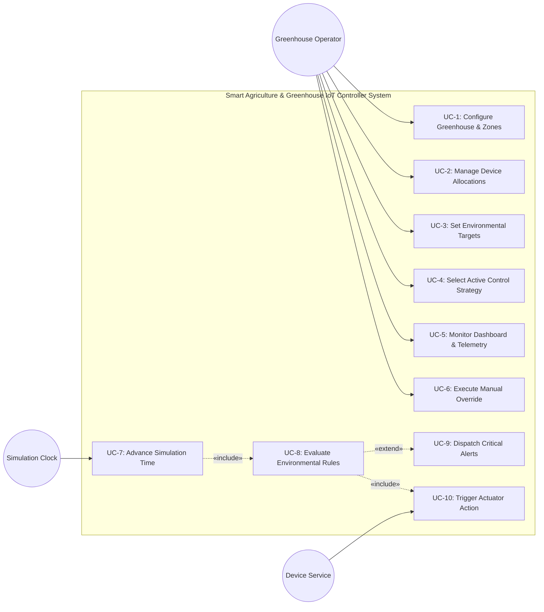

#### 3.4.2 Use case model

##### Actors
- **Greenhouse Operator / Supervisor (Primary Human Actor)**: Configures greenhouse zones, defines environmental rules, switches control strategies, inspects telemetry dashboards, and executes manual actuator overrides.
- **Simulation Clock (Primary System Actor)**: Drives virtual time progression and triggers periodic sensor telemetry sampling.
- **Hardware / Device Service (Supporting System Actor)**: Simulates physical hardware I/O, device degradation, and telemetry generation.

##### Use Case Diagram (UML)



##### Detailed Use Case Specifications

```
USE CASE: UC-1 Configure Greenhouse & Zones
---------------------------------------------------------------------------------
Primary Actor:    Greenhouse Operator
Scope:            Greenhouse Facility Configuration
Preconditions:    The system is initialized and operational.
Trigger:          Operator selects "Facility Management" from the navigation menu.
Main Flow:
  1. Operator requests creation of a new greenhouse zone.
  2. System prompts for zone identifier, label, and dimension parameters.
  3. Operator submits zone parameters.
  4. System instantiates the Zone composite object and adds it to the Greenhouse.
  5. System presents updated greenhouse layout on the dashboard.
Alternative Flow:
  2a. Duplicate zone identifier entered: System alerts operator and requests unique ID.
Postconditions:   New zone is registered, persistent, and ready for device allocation.
Associated FRs:   FR-1, FR-2, FR-5, FR-6
```

```
USE CASE: UC-4 Select Active Control Strategy
---------------------------------------------------------------------------------
Primary Actor:    Greenhouse Operator
Scope:            Environmental Control Strategy Pipeline
Preconditions:    Greenhouse facility contains at least one active zone.
Trigger:          Operator requests a policy change on the control console.
Main Flow:
  1. Operator views current active strategy (e.g., EcoMode).
  2. Operator selects an alternate policy (e.g., HighYieldGrowth or FrostProtection).
  3. System prompts for strategy application scope (global or zone-specific).
  4. Operator confirms selection.
  5. System binds the selected Strategy instance to the Rule Evaluation Engine.
  6. Subsequent environmental rule resolutions apply the new policy criteria.
Postconditions:   Active strategy updated dynamically without system restart.
Associated FRs:   FR-25, FR-26, FR-27, FR-28, FR-29
```

```
USE CASE: UC-6 Execute Manual Override
---------------------------------------------------------------------------------
Primary Actor:    Greenhouse Operator
Scope:            Actuator Subsystem
Preconditions:    Target actuator is registered in a zone and currently operational.
Trigger:          Operator clicks manual override toggle on actuator card.
Main Flow:
  1. Operator selects target actuator and commands state change (FORCE_ON / FORCE_OFF).
  2. System sets actuator state to commanded value.
  3. System updates actuator control mode from AUTOMATIC to MANUAL_OVERRIDE.
  4. System registers an audit log entry detailing operator command and timestamp.
  5. System visually flags the actuator on the dashboard as manually locked.
Alternative Flow:
  1a. Operator selects "RELEASE OVERRIDE": System restores control mode to AUTOMATIC
      and permits rule-based automation to dictate actuator state.
Postconditions:   Actuator is locked in manual state; automated rules cannot override.
Associated FRs:   FR-14, FR-15, FR-16, FR-17, FR-18
```

```
USE CASE: UC-8 Evaluate Environmental Rules
---------------------------------------------------------------------------------
Primary Actor:    Simulation Clock / Sensor Event
Scope:            Event-Driven Rule Processing
Preconditions:    Sensors are active and registered with the event bus.
Trigger:          A sensor publishes a new telemetry measurement.
Main Flow:
  1. Sensor publishes SensorUpdateEvent to the event dispatcher.
  2. Event dispatcher notifies the Rule Evaluation Engine.
  3. Rule Engine identifies all rules mapped to the reporting zone and metric type.
  4. Rule Engine polymorphically invokes evaluation logic for each rule.
  5. Condition evaluates to TRUE (e.g., soil moisture below threshold).
  6. Rule Engine queries active ControlStrategy for action arbitration.
  7. Actuation command dispatched to target actuator (UC-10).
  8. Dashboard and event logs updated with rule triggering provenance.
Alternative Flow:
  5a. Condition evaluates to FALSE: No actuator action taken; telemetry logged.
Postconditions:   Appropriate actuators activated/deactivated according to policy.
Associated FRs:   FR-10, FR-19, FR-20, FR-21, FR-22, FR-23, FR-24
```


##### Additional Detailed Use Case Specifications

```text
USE CASE: UC-2 Manage Device Allocations
----------------------------------------------------------------------------
Primary Actor:    Greenhouse Operator
Preconditions:    A greenhouse zone exists.
Trigger:          Operator opens device allocation for a zone.
Main Flow:
  1. Operator selects a zone.
  2. System displays registered and available sensors and actuators.
  3. Operator assigns or removes a device from the selected zone.
  4. System validates that the device exists and that the allocation is allowed.
  5. System saves the allocation and refreshes the zone device list.
Alternative Flow: Unknown device or invalid allocation: system rejects the change and displays an error.
Postconditions:   Selected device is assigned to or removed from the zone.
```

```text
USE CASE: UC-3 Set Environmental Targets
----------------------------------------------------------------------------
Primary Actor:    Greenhouse Operator
Preconditions:    A greenhouse zone exists.
Trigger:          Operator opens environmental target settings.
Main Flow:
  1. Operator selects a zone.
  2. System displays current temperature, moisture and sunlight targets.
  3. Operator enters new target values.
  4. System validates the target values against allowed ranges.
  5. System saves the targets for subsequent rule evaluations.
Alternative Flow: Invalid or out-of-range target: system requests correction.
Postconditions:   Validated target values are stored for the zone.
```

```text
USE CASE: UC-5 Monitor Dashboard & Telemetry
----------------------------------------------------------------------------
Primary Actor:    Greenhouse Operator
Preconditions:    At least one zone is configured.
Trigger:          Operator opens the monitoring dashboard.
Main Flow:
  1. System displays configured zones and their current device states.
  2. System displays latest sensor readings and timestamps.
  3. System identifies active actuators and manual overrides.
  4. System displays the active control strategy and recent alerts.
  5. System refreshes displayed data when new telemetry arrives.
Alternative Flow: No telemetry available: system shows a clearly marked unavailable or stale reading.
Postconditions:   Operator can inspect the latest available greenhouse state.
```

```text
USE CASE: UC-7 Advance Simulation Time
----------------------------------------------------------------------------
Primary Actor:    Simulation Clock
Preconditions:    Simulation environment is initialized.
Trigger:          Simulation clock receives a step or scheduled tick.
Main Flow:
  1. Clock advances virtual time according to the configured step or scale.
  2. System updates simulated environmental conditions.
  3. System requests new sensor readings.
  4. Sensor updates are published for rule evaluation (UC-8).
  5. System records the new virtual time and updates monitoring information.
Alternative Flow: Simulation paused: no automatic time advancement occurs.
Postconditions:   Virtual time and simulated readings advance consistently.
```

```text
USE CASE: UC-9 Dispatch Critical Alerts
----------------------------------------------------------------------------
Primary Actor:    Simulation Clock / Sensor Event
Preconditions:    An alert-worthy condition has been detected during rule evaluation.
Trigger:          Rule evaluation identifies a critical condition.
Main Flow:
  1. System creates an alert with severity, message, source and timestamp.
  2. System associates the alert with the affected zone.
  3. System publishes the alert to the monitoring interface.
  4. System records the alert in the historical event log.
  5. Operator can view the alert and its acknowledgment status.
Alternative Flow: Duplicate alert condition: system follows the configured duplicate-handling policy.
Postconditions:   Critical alert is visible and recorded.
```

```text
USE CASE: UC-10 Trigger Actuator Action
----------------------------------------------------------------------------
Primary Actor:    Hardware / Device Service
Preconditions:    Target actuator exists and is operational.
Trigger:          Rule engine issues an approved actuator command.
Main Flow:
  1. System identifies the target actuator and requested action.
  2. System checks actuator operational status and manual-override lock.
  3. If allowed, system sends the command to the actuator.
  4. Actuator updates its state and returns a result.
  5. System records the outcome and publishes the new actuator state.
Alternative Flow: Manual override or device fault: command is suppressed or rejected and the reason is logged.
Postconditions:   Permitted actuator command is applied and logged.
```

---
