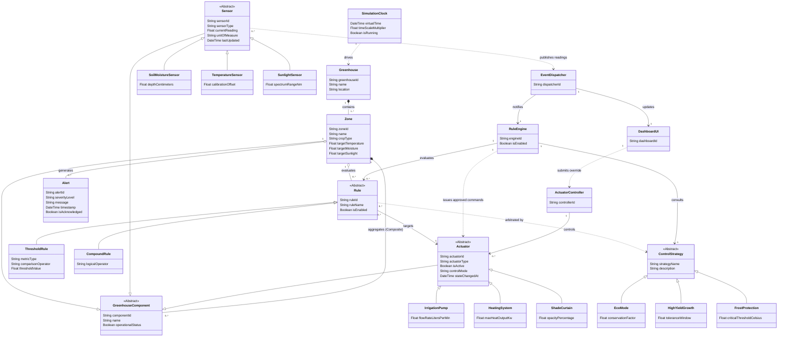

#### 3.4.3 Object model

The Conceptual Domain Model represents domain concepts, attributes, and relationships without implementation details (such as concrete class methods or database foreign keys), adhering strictly to the analysis activity standards.

---
