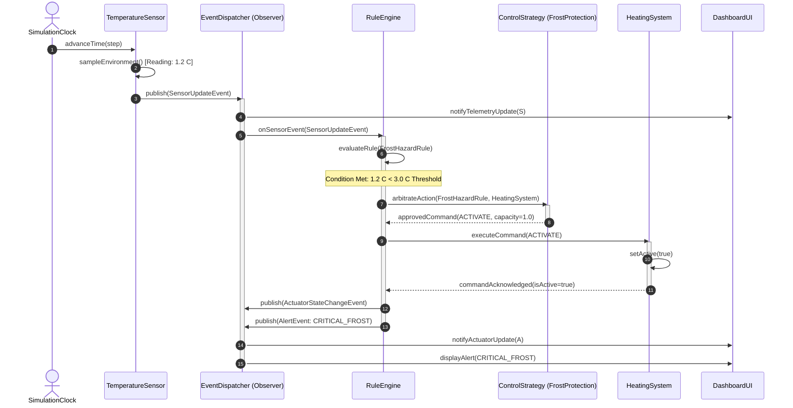
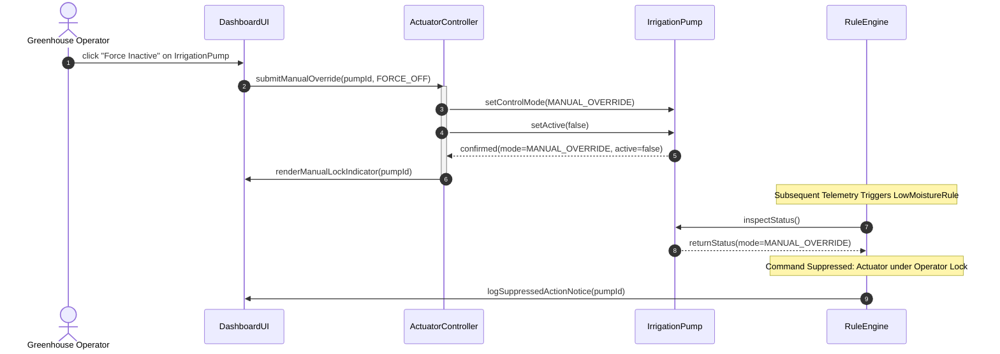
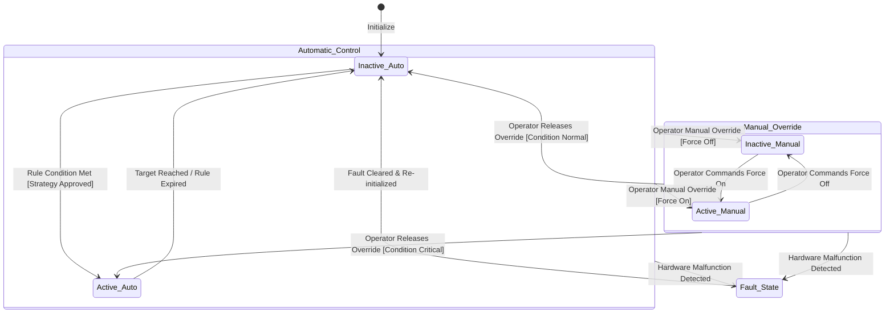

#### 3.4.4 Dynamic model

##### Sequence Diagram 1: Telemetry Event, Rule Evaluation, and Actuator Dispatch

##### Sequence Diagram 2: Manual Operator Override and Automation Suppression

##### State Machine Diagram: Actuator Lifecycle & Control State

---
