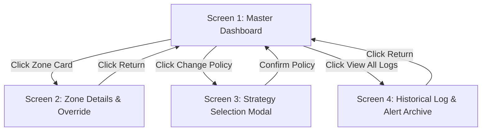

#### 3.4.5 User interfaces and Mock-ups

##### Screen 1: Master Dashboard & Zone Overview
```
+----------------------------------------------------------------------------------------------------+
| SMART AGRICULTURE & GREENHOUSE IOT CONTROLLER SYSTEM                  [Sim Time: 14:32:00 | 10x]   |
+----------------------------------------------------------------------------------------------------+
| ACTIVE STRATEGY: [ EcoMode (Resource Conservation) ]  [ Change Policy ]   | Alerts: [2 Critical]  |
+----------------------------------------------------------------------------------------------------+
| ZONE 1: TOMATO GREENHOUSE (Sector A)              | ZONE 2: NURSERY & SEEDLINGS (Sector B)         |
| Status: NORMAL                                    | Status: ALERT (FROST HAZARD WARNING)           |
|---------------------------------------------------|------------------------------------------------|
| Soil Moisture:    28.4 %   [ OK ]                 | Soil Moisture:    42.1 %   [ OK ]              |
| Temperature:      23.1 C   [ OK ]                 | Temperature:       1.8 C   [ CRITICAL LOW ]    |
| Sunlight Level:   850 Lux  [ OK ]                 | Sunlight Level:   120 Lux  [ LOW ]             |
|---------------------------------------------------|------------------------------------------------|
| ACTUATORS:                                        | ACTUATORS:                                     |
|  - Irrigation Pump:   [ OFF ] (AUTO)              |  - Irrigation Pump:   [ OFF ] (AUTO)           |
|  - Heating Coils:     [ OFF ] (AUTO)              |  - Heating Coils:     [ ON  ] (AUTO - Frost)   |
|  - Shade Curtains:    [ OPEN] (AUTO)              |  - Shade Curtains:    [ CLOSED] (AUTO)         |
| [ View Zone Details ]   [ Manual Controls ]       | [ View Zone Details ]   [ Manual Controls ]    |
+----------------------------------------------------------------------------------------------------+
| RECENT SYSTEM ALERTS & EVENT LOG:                                              [ View All Logs ]   |
| [14:31:45] CRITICAL: Zone 2 Temperature dropped to 1.8 C (Threshold: 3.0 C).                       |
| [14:31:46] ACTION: Zone 2 Heating Coils forced ON by FrostProtection strategy.                     |
| [14:28:10] NOTICE: Zone 1 Irrigation completed. Soil moisture recovered to 28.4%.                 |
+----------------------------------------------------------------------------------------------------+
```

##### Screen 2: Zone Detail and Actuator Manual Override Console
```
+----------------------------------------------------------------------------------------------------+
| ZONE 1: DETAILED CONTROLS & TELEMETRY                                          [ Return to Master ]|
+----------------------------------------------------------------------------------------------------+
| SENSOR TELEMETRY                                  | TARGET THRESHOLDS                              |
| - Soil Moisture Sensor #1: 24.2 %                 | - Moisture Target: 30% (+/- 5%)                |
| - Ambient Temp Sensor #1:  22.8 C                 | - Temperature Target: 24 C (+/- 2 C)           |
| - Sunlight Sensor #1:      740 Lux                | - Sunlight Target: 800 Lux (+/- 100 Lux)       |
+---------------------------------------------------+------------------------------------------------+
| ACTUATOR HARDWARE & MANUAL OVERRIDE CONSOLE                                                        |
|----------------------------------------------------------------------------------------------------|
| ACTUATOR NAME       | CURRENT STATE | MODE             | MANUAL ACTION CONTROLS                    |
|---------------------|---------------|------------------|-------------------------------------------|
| Irrigation Pump #1  | [ ON  ]       | MANUAL OVERRIDE  | [ FORCE ON ]  [ FORCE OFF ]  [ RELEASE ]  |
| Heating Coils #1    | [ OFF ]       | AUTOMATIC        | [ FORCE ON ]  [ FORCE OFF ]  [ RELEASE ]  |
| Shade Curtains #1   | [ OPEN]       | AUTOMATIC        | [ FORCE ON ]  [ FORCE OFF ]  [ RELEASE ]  |
+----------------------------------------------------------------------------------------------------+
| RECENT RULE EVALUATIONS FOR ZONE 1:                                                                |
| - LowMoistureRule: TRIGGERED -> Action SUPPRESSED due to active Manual Override.                   |
| - HighTempVentRule: NOT TRIGGERED (Temperature within optimal window).                             |
+----------------------------------------------------------------------------------------------------+
```

##### Screen 3: Strategy Selection Modal
```
+----------------------------------------------------------------------------------------------------+
| STRATEGY SELECTION                                                                   [ X Close ]   |
+----------------------------------------------------------------------------------------------------+
| Current Active Strategy:  EcoMode (Resource Conservation)    Applied Scope: Global                 |
|----------------------------------------------------------------------------------------------------|
| SELECT CONTROL STRATEGY:                                                                           |
|                                                                                                    |
| ( ) EcoMode            Minimizes water and electricity use; widens tolerance bands and defers      |
|                        non-critical actuation.                                                     |
| (o) HighYieldGrowth    Keeps every zone close to its optimal targets to maximize crop growth.      |
| ( ) FrostProtection    Prioritizes heating and thermal curtains over power conservation during     |
|                        low-temperature events.                                                     |
|----------------------------------------------------------------------------------------------------|
| APPLICATION SCOPE:     (o) Global (all zones)      ( ) Zone-specific: [ Zone 1: Tomato v ]         |
|----------------------------------------------------------------------------------------------------|
| NOTE: The new strategy is applied at runtime. The simulation keeps running and the next rule       |
| evaluation uses the selected policy.                                                               |
|----------------------------------------------------------------------------------------------------|
|                                                          [ Cancel ]      [ Confirm Strategy ]      |
+----------------------------------------------------------------------------------------------------+
```

##### Screen 4: Historical Log & Alert Archive
```
+----------------------------------------------------------------------------------------------------+
| HISTORICAL LOG & ALERT ARCHIVE                                              [ Return to Master ]   |
+----------------------------------------------------------------------------------------------------+
| FILTERS:  Zone: [ All Zones v ]  Severity: [ All v ]  Source: [ All v ]  Period: [ Last 24 h v ]   |
|           Search: [ ________________________ ]                         [ Apply ]  [ Clear ]        |
+----------------------------------------------------------------------------------------------------+
| TIME      | ZONE   | SEVERITY | SOURCE          | MESSAGE                                    | ACK |
|----------------------------------------------------------------------------------------------------|
| 14:31:46  | Zone 2 | ACTION   | FrostProtection | Heating Coils #2 activated (100%)          |  -  |
| 14:31:45  | Zone 2 | CRITICAL | FrostHazardRule | Temperature dropped to 1.8 C (limit 3.0 C) | [ ] |
| 14:20:40  | Zone 1 | WARNING  | LowMoistureRule | Activation suppressed (Manual Override)    | [x] |
| 14:20:03  | Zone 1 | NOTICE   | Manual Operator | Irrigation Pump #1 FORCE OFF (override)    |  -  |
| 13:55:12  | Zone 1 | WARNING  | Device Service  | Sunlight Sensor #1 unresponsive (fault)    | [x] |
| 13:02:30  | Zone 1 | ACTION   | LowMoistureRule | Irrigation Pump #1 activated under EcoMode |  -  |
|----------------------------------------------------------------------------------------------------|
| TELEMETRY HISTORY (Zone 2 - Temperature, C):                                                       |
|   6.0 |*****                                                                                       |
|   4.0 |     ****                                                                                   |
|   2.0 |         ****                                                                               |
|   0.0 +-------------------------> virtual time                                                     |
|----------------------------------------------------------------------------------------------------|
| Showing 6 of 248 entries        [ < Prev ]  Page 1 / 42  [ Next > ]   [ Acknowledge Selected ]     |
+----------------------------------------------------------------------------------------------------+
```

##### Navigational Paths & Screen Transitions



---
